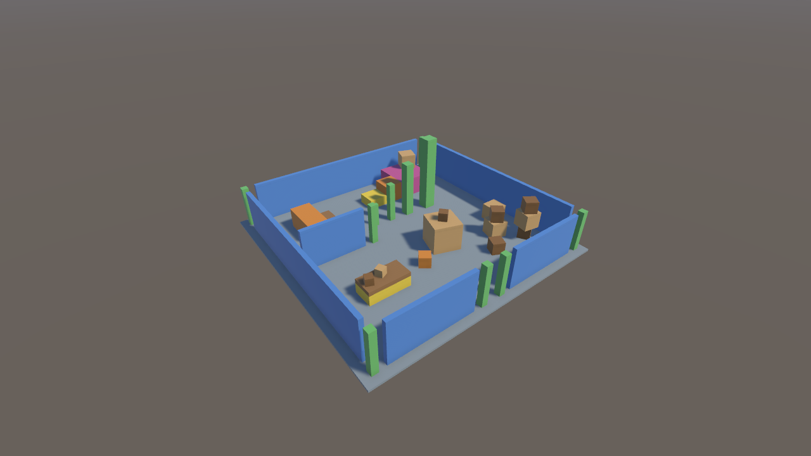

# Grid Level Design

An editor tool for Unity that lets you build levels by placing your own 3D prefabs on a grid, straight in the Scene view.

Pick a prefab from a palette, see a ghost preview where it will land, and paint, drag rectangles, draw lines or flood fill. Turn grid snapping off to place pieces freely. Pieces can stack on top of each other, span several cells, rotate by any angle, be resized, and be selected later to rotate, scale or delete. Levels can be saved to an asset or exported as JSON.



Everything runs in edit mode. Only two small data scripts live outside the Editor folder (they need to be components and assets); none of the tool code is included in builds.

## Requirements

- Unity 6 (6000.0) or newer. Developed and tested on 6000.6 with URP.
- Works with any render pipeline. The ghost and highlights use Unity's built-in editor shader.

## Installation

### From Git URL

1. Open **Window > Package Manager**.
2. Click **+** and choose **Install package from git URL...**
3. Enter:

```
https://github.com/Manzot/unity-grid-level-design.git
```

### Embedded

Clone or download this repository into your project's `Packages` folder.

### Try the demo

In Package Manager, select **Grid Level Design**, open **Samples** and import **Demo Scene and Test Prefabs**. It adds:

- **Demo/GridLevelDemo** – the room in the screenshot above, built with the tool, including resized off-grid pieces. Select **Grid Level**, activate the Grid Level Tool and keep building.
- **Demo/DemoPalette** – a palette with every test prefab; the crate entry has a variant and random rotation. Assign it in the palette window.
- **Demo/DemoLevel** – the room saved as Level Data, linked to the scene's Grid Level for trying Save and Load.
- **Prefabs** and **Materials** – simple blocks, walls, floors, planks and crates with 1x1, 2x1 and 2x2 footprints.

The sample materials use URP's Lit shader. In a Built-in or HDRP project they show pink until you switch them to that pipeline's shader; the tool itself works in every pipeline.

## Quick start

1. **GameObject > Grid Level** creates a grid object in the scene.
2. **Window > Grid Level > Palette** opens the palette. Click **New** to create a palette asset, then drag prefabs or a folder into the window, or use **Add Folder**.
3. Select the Grid Level object, then choose **Grid Level Tool** in the Scene view's Tools overlay.
4. Click a prefab in the palette and click or drag in the Scene view to place it.

## Tools

| Mode | Key | Place | Erase (hold Shift or Erase on) |
|---|---|---|---|
| Paint | B | Click or drag; every cell the cursor crosses | Drag over pieces |
| Rect | M | Drag a rectangle, tiled with whole footprints | Clears the rectangle |
| Line | L | Drag a straight line | Clears the line |
| Fill | K | Floods the connected empty area | Clears connected pieces of the same entry |
| Select | U | Click or box select placed pieces | - |

## Shortcuts

| Key | Action |
|---|---|
| Shift + Drag | Erase while held |
| X | Toggle erase mode |
| S | Toggle stacking on top of existing pieces |
| N | Toggle snap to grid (off = freeform placement in Paint mode) |
| C | Freeform snap centres: Bounds (box of the piece) or Faces (flat faces, for off-centre openings) |
| I | Pick the prefab and rotation under the cursor |
| , and . | Rotate left / right by the step angle (in Select mode, rotates the selection) |
| / | Cycle the rotation axis X / Y / Z |
| - and = | Scale down / up by the scale step (in Select mode, scales the selection) |
| [ and ] | Layer down / up |
| G | Cycle plane XZ / XY / YZ |
| Del | Delete selected pieces (Select mode) |
| Esc | Cancel a drag, or clear the selection |
| F | Focus the selection, or the last piece placed, picked or selected |
| Shift + F | Frame the whole grid |

The **Shortcuts** button in the overlay shows the same list inside the editor. While the right mouse button is held (Unity's fly mode), the tool ignores its shortcuts so W A S D Q E move the camera.

## Features

- **Grid:** XZ, XY or YZ plane, per-axis cell size, Grid Size in cells across, layers step by one cell along the plane's normal. With several grids in a scene, only the selected one is drawn.
- **Ghost preview:** a translucent copy of the next piece, drawn on top of whatever is already in the cell, red when the spot is blocked, with a facing arrow and angle label.
- **Stacking:** with Stack on, new pieces rest on top of existing ones, using real mesh height.
- **Footprints:** calculated automatically from each prefab's bounds for the current grid's plane and cell size. Tick Manual Footprint on a palette entry to set it yourself.
- **Rotation:** any step angle, default 90, around X, Y or Z. Multi-cell footprints swap on quarter turns; tilted pieces are re-seated on the grid.
- **Scale:** each palette entry has a Scale setting and an optional Fit to Cell, and the overlay's scale tool resizes the next piece or the selection by an adjustable step.
- **Freeform placement:** with Snap to Grid off, Paint places pieces exactly at the cursor, optionally rounded to a Fine snap increment. With Stack on they land on top of whatever is under the cursor; with Stack off they stay at the layer's height.
- **Snap points:** in freeform, the piece under the cursor shows dots on its top, sides and bottom. Move the cursor near a dot and the next piece's matching face attaches to it, centred. **Snap Centres** (C) picks where the dots sit: Bounds, the default, uses the piece's box so uneven or organic meshes line up centred; Faces uses the real flat faces, so pipe openings that are off-centre line up.
- **Variants:** each palette entry can list variant prefabs; every placement picks one at random. Optional random rotation.
- **Random position:** each palette entry has a Random Position offset. Every grid placement moves the piece by a random amount from 0 to that value on each grid axis; the ghost shows the exact result. Not applied in freeform.
- **Palette in the overlay:** the **Palette** section at the bottom of the overlay shows the palette's prefabs to pick from, and **Prefab Settings** edits the selected entry, so the palette window is only needed to add or remove prefabs.
- **Selection:** click the piece under the cursor, box select on screen or Shift-add, then rotate, scale or delete. Selected pieces are tinted and outlined.
- **Undo:** every stroke, fill, rotation, delete, load and clear is a single undo step.

## Saving and loading

The Grid Level component's Inspector has a **Level** section:

- **Save As...** writes a **Level Data** asset and links it. **Save** overwrites the linked asset.
- **Load** replaces the scene pieces with the linked asset.
- **Export JSON...** and **Import JSON...** use a text file that references prefabs by GUID, with the asset path as a fallback.
- **Clear** removes every piece.

Saved data keeps each piece's prefab, cell, footprint, rotation and exact local transform, so stack heights and hand adjustments survive.

## Pivot convention

Prefabs are placed with their pivot at the bottom centre of their footprint. If a prefab's pivot sits elsewhere, set **Pivot Offset** on its palette entry.

## Known limitations

- Prefabs stay upright on the XY and YZ planes, and stacking always goes along Y.
- Removing a lower piece by hand does not drop the pieces stacked on it.
- Rotating a selection does not check for overlap with neighbouring pieces.
- At angles that aren't multiples of 90, multi-cell pieces can overhang neighbouring cells.
- Grid and freeform pieces ignore each other: freeform pieces don't block grid cells, and grid erase and fill don't touch them.
- The scale tool doesn't change a piece's grid footprint, so an enlarged grid piece can overlap its neighbours.
- Freeform placement doesn't check for overlap: pieces can be placed through each other.
- Freeform drop height and snap points use axis-aligned bounds and mesh vertices, so rounded or rotated pieces can land slightly off what you'd expect.
- Snap points only work on XZ (floor) grids, and they move the next piece without turning it.

## License

MIT. See [LICENSE.md](LICENSE.md).
